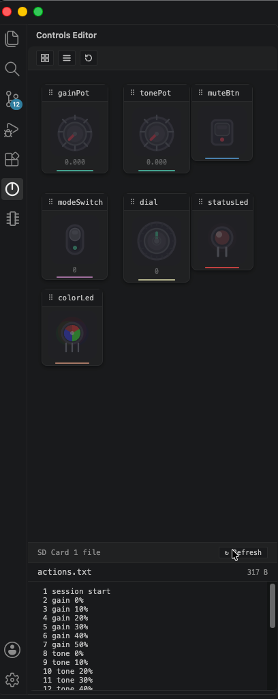

# Daisy Seed IDE

Write, run and debug [Daisy Seed](https://electro-smith.com/products/daisy-seed) audio effects in VS Code, **without the hardware**. Build your C++ effect as a native program, play audio through it, turn virtual knobs, watch the waveform and spectrum, and stop at a breakpoint inside the audio callback. Flash it to a real Daisy Seed when you are ready.

It replaces the slow loop of compile, flash, plug in an instrument and listen with a fast one: edit, run, listen, adjust.

> **Preview release.** Daisy IDE is in early access. It works, but expect rough edges, some UI changes between versions, and a few known issues (see [Known issues](#known-issues) and [Limitations](#limitations)). Feedback is the reason this preview exists: please [tell us what you find](#feedback).
>
> **macOS on Apple Silicon only** for now.


---

## Requirements

- **VS Code** 1.85 or later
- **macOS on Apple Silicon (arm64)** — Intel Macs, Linux and Windows are not supported
- **CMake** 3.19 or later (for emulator builds)
- A Daisy Seed C++ project with a `CMakeLists.txt`

Physical Daisy Seed hardware is **not required** for development or debugging. It is only needed when using the hardware build and flash commands.

---

## Installation

Install the `.vsix` package directly from VS Code:

1. Open the Command Palette (`Cmd+Shift+P`)
2. Run **Extensions: Install from VSIX…**
3. Select the `ds-ide-<version>.vsix` file

To build the `.vsix` yourself:

```sh
npm install
npm run package
```

---

## Quickstart

1. Open your Daisy Seed project folder in VS Code
   — when VS Code asks whether you trust the authors of the folder, choose **Yes, I trust the authors**: Daisy IDE builds and runs your project's code, so it stays inactive in an untrusted (Restricted Mode) window
2. `Cmd+Shift+P` → **Daisy IDE: Build for Emulator** — compiles the project as a native desktop binary
3. **Daisy IDE: Deploy to Emulator** — launches the emulator process
4. **Daisy IDE: Start Audio** — begins audio processing; the Scope panel opens automatically
5. Interact with virtual potentiometers and buttons in the scope panel; observe the output waveform and spectrum

---

## Features

- **Waveform scope** — real-time oscilloscope view of the emulator audio output
- **Spectrum / FFT view** — frequency-domain analysis of the output signal
- **Audio input** — sine generator (configurable frequency and amplitude), live host microphone, or WAV file
- **Session recording** — capture emulator audio output to a WAV file
- **Controls Editor** — interactive panel for adjusting virtual potentiometers and buttons at runtime; driven by the `controllers.yaml` file and the `ds-ide:controls` C++ convention
- **Wiring Editor** — design-time pinout panel; click Daisy Seed pins to assign hardware devices; writes C++ declarations automatically
- **Hardware build** — compile the project for the physical Daisy Seed (separate CMake target)
- **DFU flash** — flash the compiled binary to a connected Daisy Seed over USB
- **Breakpoint debugging** — full lldb-based debugger via the `daisy-debug` launch configuration (breakpoints, step, variables, call stack)

---

## Wiring Editor


Open with **Daisy IDE: Focus Wiring Editor** (`Cmd+Shift+P`), or the Wiring Editor icon in the Activity Bar.

The Wiring Editor shows the full Daisy Seed 40-pin layout. Drag a device from the palette onto the board; the pins it can use light up as you drag, and dropping it opens a confirmation popover:

- **Pot** — maps to an ADC channel (`AdcChannelConfig`). A warning badge appears when the selected pin is not ADC-capable (D0–D14, D27–D30), but the assignment is still allowed.
- **Button** — maps to a GPIO input (`Switch`)
- **LED** — maps to a GPIO output (`Led`)

Each device requires a unique **id** (pre-filled with `pot1`, `button1`, `led1`, etc.). On confirm, the extension writes a declaration to the `ds-ide:controls` block in the effect source file via an undoable workspace edit (`Cmd+Z` restores the original).

Clicking a placed device shows its type and id, plus **Show panel** (for the OLED and MIDI devices), **Reveal in code** and **Remove**, which deletes the declaration from the source file.

After any change, the Controls Editor is updated automatically to reflect the new wiring.

---

## Controls Editor



The Controls Editor is part of the Scope panel, opened automatically when audio starts. It operates in two modes:

- **Design mode** — shown when audio is stopped; lets you add, remove, and reposition virtual controls defined in `controllers.yaml`
- **Run mode** — shown while audio is running; renders live interactive sliders and buttons that send values to the emulator in real time

The editor reads `controllers.yaml` from the project root and the `ds-ide:controls` block from the effect source to determine which controls to display. If no convention block is found, a diagnostic banner prompts you to add one or use the Wiring Editor.

---

## Debugging

Add a `daisy-debug` launch configuration to `.vscode/launch.json`:

```json
{
  "type": "daisy-debug",
  "request": "attach",
  "name": "Attach to Emulator",
  "pid": 0
}
```

1. Deploy the emulator (**Daisy IDE: Deploy to Emulator**)
2. Start the debug session — VS Code attaches lldb to the running emulator process
3. Set breakpoints in your C++ source; step, inspect variables, and view the call stack normally

---

## Configuration

These workspace settings can be placed in `.vscode/settings.json`:

| Setting               | Type     | Default         | Description                                                                                                                                           |
|-----------------------|----------|-----------------|-------------------------------------------------------------------------------------------------------------------------------------------------------|
| `ds-ide.effectSource` | `string` | _(auto-detect)_ | Path to the effect `.cpp` file, relative to the workspace root. When unset, the extension auto-detects the first `.cpp` adjacent to `CMakeLists.txt`. |

The following state is persisted per workspace (not user-editable directly; managed by the extension UI):

| Key                  | Description                                                          |
|----------------------|----------------------------------------------------------------------|
| `ds-ide.sine`        | Sine generator frequency and amplitude                               |
| `ds-ide.audioSource` | Audio input source, sample rate, buffer size, WAV path and loop flag |

---

## Testing

- **`npm test`** — vitest unit suite (mocked `vscode` module). Fast, runs on every `npm run lint`-adjacent check; this is the suite to run while iterating.
- **`npm run test:e2e`** — functional/e2e suite (`@vscode/test-cli` + `@vscode/test-electron`). Builds the extension, then launches a real VS Code Extension Development Host and exercises real activation, real `vscode.commands` dispatch, and real IPC round-trips — things the mocked unit suite can't prove. Slower (downloads a real VS Code build on first run) and **not** part of `npm test` or `npm run lint` — run it explicitly before a release, or when changing activation/command-registration/IPC-boundary code. Specs live in `src/test/e2e/`.
- **`src/test/manual/manual-tests.html`** — hand-run checklist for cases neither automated suite can cover (real audio I/O, hardware build/flash, webview rendering).

---

## Known limitations

- **macOS on Apple Silicon only** — the emulator is built for macOS and the extension is published as an arm64 package. Intel Macs, Linux and Windows are not currently supported.
- **Not cycle-accurate** — the emulator runs a host compatibility layer, not an STM32 simulation. CPU and RAM budget cannot be validated against the real hardware.
- **Audio fidelity caveat** — the emulator approximates Daisy Seed audio behavior; it is not bit-exact with the hardware output.

---

## Appendix: Code conventions

### `ds-ide:controls` block

The `ds-ide:controls` block is a fenced region in your effect `.cpp` file that declares the hardware devices assigned via the Wiring Editor. The Controls Editor reads this block at startup to determine which controls to display.

**Format:**

```cpp
// ds-ide:controls:begin
AdcChannelConfig volume;  // ds-ide: id=volume, kind=pot, pin=15
Switch bypass;            // ds-ide: id=bypass, kind=button, pin=0
Led statusLed;            // ds-ide: id=statusLed, kind=led, pin=13
// ds-ide:controls:end
```

Rules:
- The block is delimited by `// ds-ide:controls:begin` and `// ds-ide:controls:end` on their own lines.
- Each declaration line must include a trailing annotation comment in the form `// ds-ide: id=<id>, kind=<pot|button|led>, pin=<n>`.
- The C++ type on the left-hand side is informational; the annotation is the authoritative source for the extension.
- `id` must be unique within the block.
- `pin` is the Daisy Seed pin number (0–30 for GPIO; 15–26 for ADC).
- The block is written and maintained by the Wiring Editor. Manual edits are supported as long as the annotation format is preserved.

**C++ type mapping:**

| `kind`   | C++ type           |
|----------|--------------------|
| `pot`    | `AdcChannelConfig` |
| `button` | `Switch`           |
| `led`    | `Led`              |

---

### `controllers.yaml`

`controllers.yaml` is a project-level file (place it in the workspace root) that configures the virtual controls displayed in the Controls Editor. It has three optional top-level sections: `controllers:` (potentiometers), `buttons:`, and `leds:`.

**Full example:**

```yaml
controllers:
  - id: volume
    label: Volume
    adc_channel: 0
    range: [0, 1]
    taper: linear
    default: 0.5

  - id: cutoff
    label: Cutoff Freq
    adc_channel: 1
    range: [200, 8000]
    taper: log
    default: 0.3

buttons:
  - id: bypass
    label: Bypass
    gpio_pin: 0
    mode: toggle
    active_level: low

leds:
  - id: statusLed
    label: Status
    gpio_pin: 13
```

**`controllers:` section (potentiometers)**

| Field         | Type         | Required | Description                                                                              |
|---------------|--------------|----------|------------------------------------------------------------------------------------------|
| `id`          | string       | yes      | Unique identifier. Must match the `id` in the `ds-ide:controls` annotation.              |
| `label`       | string       | yes      | Human-readable label shown in the Controls Editor.                                       |
| `adc_channel` | integer      | yes      | ADC channel number, 0–11. Must be unique across all pots.                                |
| `range`       | `[min, max]` | yes      | Value range sent to the emulator (e.g. `[0, 1]`, `[200, 8000]`).                         |
| `taper`       | string       | yes      | `linear`, `log`, or `antilog`. Controls how slider position maps to value.               |
| `default`     | number       | yes      | Initial slider position, normalised 0–1.                                                 |
| `editor_pos`  | `[x, y]`     | no       | Canvas position in the Controls Editor (managed by drag-and-drop; do not edit manually). |

**`buttons:` section**

| Field          | Type     | Required | Default     | Description                                                                    |
|----------------|----------|----------|-------------|--------------------------------------------------------------------------------|
| `id`           | string   | yes      | —           | Unique identifier.                                                             |
| `label`        | string   | yes      | —           | Human-readable label.                                                          |
| `gpio_pin`     | integer  | yes      | —           | Daisy Seed pin number, 0–31. Must be unique across all buttons.                |
| `mode`         | string   | no       | `momentary` | `momentary` (held) or `toggle` (latched).                                      |
| `active_level` | string   | no       | `low`       | `high` or `low`. Wiring metadata; the runtime returns the logical press state. |
| `editor_pos`   | `[x, y]` | no       | —           | Canvas position (managed by the editor).                                       |

**`leds:` section**

| Field        | Type     | Required | Description                                                                             |
|--------------|----------|----------|-----------------------------------------------------------------------------------------|
| `id`         | string   | yes      | Unique identifier.                                                                      |
| `label`      | string   | yes      | Human-readable label.                                                                   |
| `gpio_pin`   | integer  | yes      | Daisy Seed pin number, 0–31. Pin 23 is the onboard LED. Must be unique across all LEDs. |
| `editor_pos` | `[x, y]` | no       | Canvas position (managed by the editor).                                                |

Validation errors in `controllers.yaml` are reported as VS Code diagnostics in the Problems panel.

---

## License

MIT
