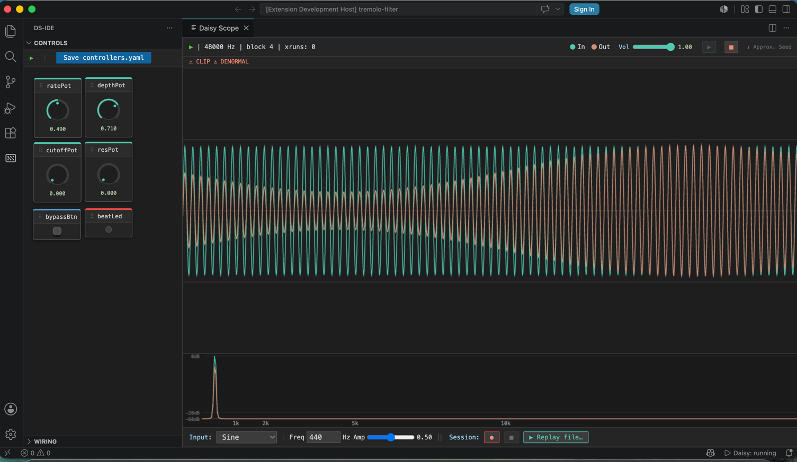
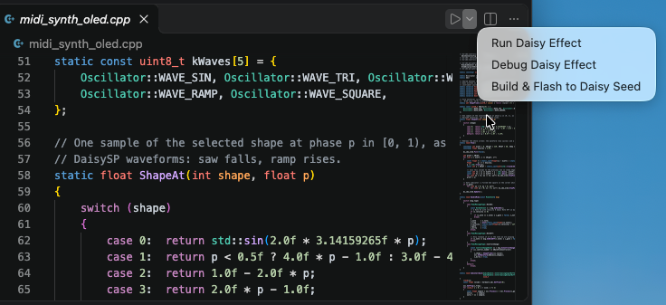
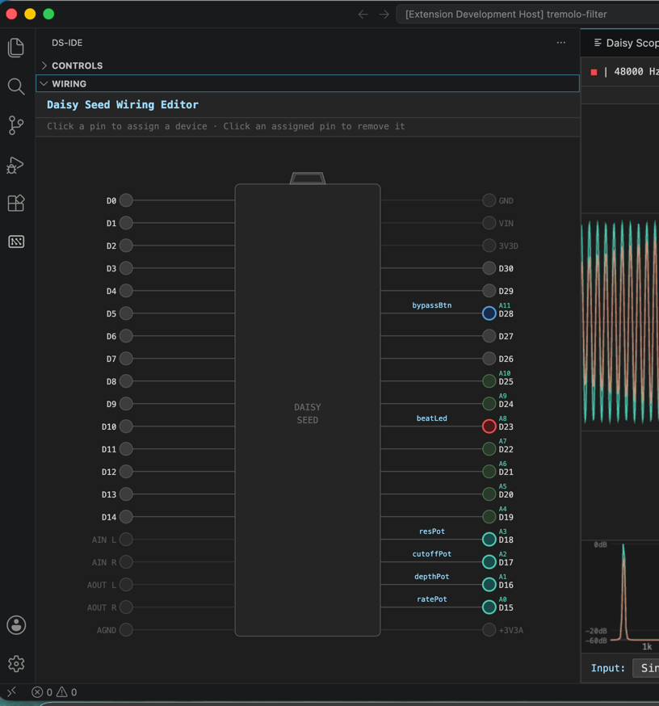
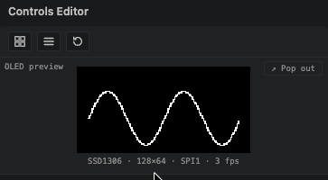
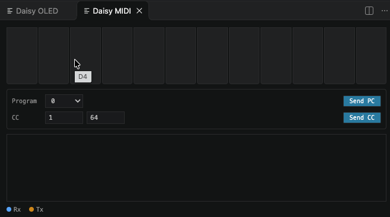
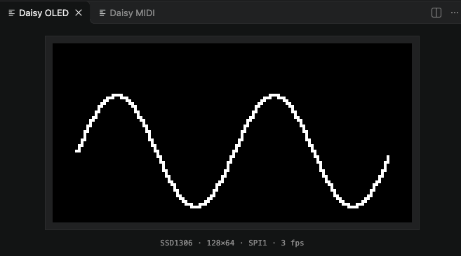
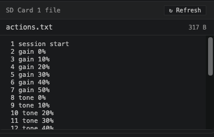

# Daisy Seed IDE

Write, run and debug [Daisy Seed](https://electro-smith.com/products/daisy-seed) audio effects in VS Code, **without the hardware**. Build your C++ effect as a native program, play audio through it, turn virtual knobs, watch the waveform and spectrum, and stop at a breakpoint inside the audio callback. Flash it to a real Daisy Seed when you are ready.

It replaces the slow loop of compile, flash, plug in an instrument and listen with a fast one: edit, run, listen, adjust.

> **Preview release.** Daisy IDE is in early access. It works, but expect rough edges, some UI changes between versions, and a few known issues (see [Known issues](#known-issues) and [Limitations](#limitations)). Feedback is the reason this preview exists: please [tell us what you find](#feedback).
>
> **macOS on Apple Silicon only** for now.



---

## Requirements

**To build and run effects on the emulator** (everything except flashing hardware):

- **macOS on Apple Silicon (arm64)**. Intel Macs, Linux and Windows are not supported yet.
- **VS Code** 1.140 or later.
- **CMake** 3.20 or later: `brew install cmake`.
- **Xcode Command Line Tools**: `xcode-select --install`. They provide the C++ compiler the emulator build uses and `lldb-dap`, the debugger.

**Only to build for and flash a real Daisy Seed** (optional):

- The **Arm GNU toolchain**: `brew install arm-none-eabi-gcc`.
- **dfu-util**: `brew install dfu-util`.
- A Daisy Seed board and a USB cable.
- A libDaisy-style project with a `Makefile` (see [Limitations](#limitations)).

You do not need a Daisy Seed to write, run, listen to or debug an effect.

---

## Installation

**From the Marketplace.** Search for **Daisy Seed IDE** in the Extensions view and choose **Install Pre-Release Version**, or run:

```sh
code --install-extension daisy-ide.ds-ide --pre-release
```

**From a `.vsix` file.** Open the Command Palette (`Cmd+Shift+P`), run **Extensions: Install from VSIX…** and select the `ds-ide-darwin-arm64-<version>.vsix` file.

**Trust the folder.** When you open a project, VS Code asks whether you trust the authors of the folder. Choose **Yes, I trust the authors**. Daisy IDE builds and runs your project's code, so it stays inactive, and its editors stay hidden, in an untrusted (Restricted Mode) window.

---

## Quickstart

### Try an example

The extension ships five small examples in its `examples/` folder, starting with `tremolo-filter`, an effect with four pots, a bypass button and a beat LED. They are also in the [repository](https://github.com/bobpuley/ds-ide/tree/main/examples), and [`examples/README.md`](examples/README.md) says which to try in what order.

1. Copy the `tremolo-filter` folder somewhere you can edit it (builds write a `.ds-ide/` folder into the project). In an installed extension it is in `~/.vscode/extensions/daisy-ide.ds-ide-<version>/examples/`.
2. Open that folder in VS Code (**File > Open Folder**) and trust it when asked.
3. Open `tremolo_filter.cpp` and click the **play button** at the top right of the editor, or run **Daisy IDE: Run Daisy Effect** from the Command Palette (`Cmd+Shift+P`). It builds the effect, starts the emulator and plays. The first build takes a little longer because it compiles DaisySP.
4. The **Scope** opens with the waveform and spectrum. Open the **Controls Editor** from the Activity Bar and turn the pots, press the Bypass button, and watch the output change.
5. Stop with **Daisy IDE: Stop Daisy Effect**.



The arrow next to the play button opens a menu with **Run Daisy Effect**, **Debug Daisy Effect** and **Build & Flash to Daisy Seed**.

### Start your own effect

Run **Daisy IDE: Create New Effect Project** (or press the button in the Daisy view). Give it a name and a location, and it creates a working effect with DaisySP included and opens it. Then click the play button, as above. The **Get started with Daisy Seed** walkthrough on the Welcome page covers the same path.

Run Daisy Effect does three things in one go. If you prefer the steps one at a time, they are also commands: **Daisy IDE: Build for Emulator**, **Daisy IDE: Deploy to Emulator** and **Daisy IDE: Start Audio**.

---

## Features

- **Run on a native emulator**: your effect is built as a desktop program against a host libDaisy compatibility layer. It is not a cycle-accurate STM32 simulation.
- **Scope and spectrum**: waveforms for the input and both outputs, a log or linear spectrum, peak and RMS meters, clip detection, an edge trigger, and PNG and CSV export.
- **Input sources**: sine and other test signals (noise, log sweep, impulse, step, silence, two-tone), your microphone, or a WAV file.
- **Session record and replay**: record a run to a file and play it back.
- **Controls Editor**: virtual pots, buttons, toggles, encoders, LEDs and RGB LEDs that you can drag, turn and click while the effect runs.
- **Wiring Editor**: place devices on a Daisy Seed pinout and the extension writes the matching C++ declarations and init code for you.
- **Peripherals**: SD card, OLED display and MIDI (USB and TRS), each with a viewer, plus an on-screen MIDI keyboard.
- **Breakpoint debugging**: stop inside your audio callback, step, inspect variables and the call stack.
- **Hardware build and DFU flash**: build the same project for a real Daisy Seed and flash it over USB.
- **Five examples** to learn from, with a README each.

---

## Examples

Open any of these as a folder and click the play button. Each has its own README that says what to try and what you will learn. [`examples/README.md`](examples/README.md) gives the suggested order.

| Example | Shows |
|---|---|
| [`tremolo-filter`](examples/tremolo-filter/) | A complete DaisySP effect with four pots, a button and an LED; the Scope, the spectrum and breakpoint debugging |
| [`controls-tour`](examples/controls-tour/) | Pot, button, toggle, LED, RGB LED and encoder, in plain libDaisy |
| [`midi-synth`](examples/midi-synth/) | A synth played from the on-screen MIDI keyboard; a Control Change message switches the waveform |
| [`midi-synth-oled`](examples/midi-synth-oled/) | The same synth with an OLED that draws the selected waveform |
| [`controls-sd-logger`](examples/controls-sd-logger/) | An SD card that logs every control action, and how to do file I/O off the audio thread |

---

## Scope

The Scope opens when an effect runs (or on demand with **Daisy IDE: Show Scope**).

- **Waveform**: the input and the left and right outputs, with a time base, gain, a linear or dBFS amplitude scale, a cursor read-out, and **Freeze**.
- **Trigger**: free-run, rising or falling edge on the input or the output, with a draggable level marker. **1× Single** freezes the display on the next triggered capture, and it catches short transients.
- **Spectrum**: linear or log frequency, relative or absolute dBFS.
- **Meters and events**: peak, RMS and peak hold per channel, a latching clip indicator, headroom, and a history of clips, denormals and audio underruns.
- **Export**: a PNG snapshot of the scope and spectrum, or a CSV of the visible samples.
- **Input**: choose a generator, the microphone or a WAV file in the toolbar; a generator shows its own parameters (frequency, amplitude and so on). Sample rate and buffer size are set here too.
- **Session**: record a run and replay it later.

---

## Wiring Editor



Open it with **Daisy IDE: Focus Wiring Editor** (`Cmd+Shift+P`), or the Wiring Editor icon in the Activity Bar.

The Wiring Editor shows the Daisy Seed's pin layout. Drag a device from the palette onto the board; the pins it can use light up as you drag, and dropping it opens a confirmation popover. The devices are:

- **Pot**: an analog input (`AdcChannelConfig`). A warning appears if the pin is not ADC-capable (D0 to D14, D27 to D30), but you can still use it.
- **Button** (`Switch`), **Toggle** (a three-position `Switch3`) and **Encoder** (`Encoder`, three pins).
- **LED** (`Led`) and **RGB LED** (`RgbLed`, three pins).

The **Peripherals** section switches on the bus devices: **SD card**, **OLED** (SPI or I2C), **MIDI over TRS** and **MIDI over USB** (the board's USB port or an external USB connection).

Each device needs a unique **id** (pre-filled as `pot1`, `button1`, `led1` and so on). On confirm, the extension writes the declaration into the `ds-ide:controls` block (and the init lines into its init block) of your effect source, as an undoable edit: `Cmd+Z` restores the original. Click a placed device for its type and id, **Show panel** (OLED and MIDI), **Reveal in code**, and **Remove**. The Controls Editor updates automatically after any change.

---

## Controls Editor


Open it from the Activity Bar, or with **Daisy IDE: Focus Controls Editor**. It has two modes:

- **Design mode**, while the effect is stopped: move the control cards around, with **Align to grid**, **Auto-arrange** and **Reset positions** buttons.
- **Run mode**, while it runs: the controls are live. Drag a pot's knob, press a button, click a toggle to step through its positions, drag an encoder up or down, and watch the LEDs. Every change reaches your code at once.

The editor reads the `ds-ide:controls` block in your effect source and the labels, ranges and positions in `controllers.yaml` (see [Code conventions](#appendix-code-conventions)). If it finds no block, a banner offers to open the Wiring Editor. When an SD card is switched on, an **SD Card** section lists the files in your project's `sdcard/` folder and previews text files, and an OLED can be shown in place.



---

## MIDI, OLED and SD card

- **MIDI**: **Daisy IDE: Show MIDI Panel** opens an on-screen keyboard that plays notes into your effect, a sender for Program Change and Control Change messages, and a monitor of what was received and sent.

  

- **OLED**: **Daisy IDE: Show OLED Display** shows the 128 by 64 display your effect draws on. The emulator's display supports single pixels only (see [Limitations](#limitations)).

  

- **SD card**: the emulated card is the `sdcard/` folder in your project. Files your effect writes appear there, and in the Controls Editor's SD Card section, which follows the card while the effect runs.

  

---

## Debugging

1. Open your effect and set breakpoints in the C++ source.
2. Run **Daisy IDE: Debug Daisy Effect**. It builds, starts the emulator under the debugger and stops at your breakpoints.
3. Step, inspect variables and read the call stack as you would in any VS Code debug session.

Debugging uses `lldb-dap`, which comes with the Xcode Command Line Tools. **Daisy IDE: Stop Daisy Effect** ends the session.

---

## Hardware

When the effect is ready, build the same project for a real Daisy Seed:

1. **Daisy IDE: Build for Hardware** compiles it with the Arm GNU toolchain. Memory-region overflows are reported as problems.
2. Put the board in DFU mode and run **Daisy IDE: Flash to Daisy Seed** (or **Daisy IDE: Build & Flash to Daisy Seed** for both steps).

The hardware build needs a libDaisy-style project with a `Makefile` (see [Limitations](#limitations)). The `ds-ide.hardwareVariant` setting says whether your board has the extra 65 MB of SDRAM, so SDRAM use that would fail on the base board is caught.

---

## Working with an AI coding agent

If you use an AI coding agent (Claude Code, Copilot, Codex, Cursor and others) to write or adapt effects, give it the Daisy IDE guide. [`DAISY_IDE_AI_GUIDE.md`](ai/DAISY_IDE_AI_GUIDE.md) is written for the agent, not for you: it lists the code conventions the IDE depends on (the `ds-ide:` blocks in the effect source, `controllers.yaml`), which libDaisy and DaisySP APIs the emulator supports, and a checklist for adapting an existing effect.

- **New projects.** **Daisy IDE: Create New Effect Project** adds `DAISY_IDE_AI_GUIDE.md` and an `AGENTS.md` that points to it.
- **Existing projects.** Run **Daisy IDE: Add AI Guide to Project**. It copies the guide into the project folder, then looks for the agent files that are already there (`AGENTS.md`, `CLAUDE.md`, `GEMINI.md`, `.github/copilot-instructions.md`, `.cursorrules`, `.windsurfrules`, `.clinerules`) and lets you choose which ones get a one-line pointer to the guide. If there is none, it offers to create `AGENTS.md`.

The command only appends one marked line to the files you pick. It never rewrites what is in them, and running it again changes nothing. It asks before replacing a `DAISY_IDE_AI_GUIDE.md` you have edited. The guide describes this release of Daisy IDE; run the command again after an update to refresh it.

---

## Configuration

These settings go in `.vscode/settings.json` (or the Settings UI):

| Setting | Default | Description |
|---|---|---|
| `ds-ide.effectSource` | _(auto-detect)_ | Path to the effect `.cpp` file, relative to the project root or absolute. When empty, the extension finds the effect source in the project root, `src/` or `source/`. |
| `ds-ide.armToolchainPath` | _(auto-detect)_ | Path to the Arm toolchain binary or its `bin/` folder, for hardware builds. Machine-specific, so it is not synced. |
| `ds-ide.hardwareVariant` | `base` | Which Daisy Seed variant the project targets: `base` or `65mb-sdram`. |

---

## Known issues

This is a preview, so some rough edges are known:

- **The VS Code window can occasionally close right after you open a folder.** It was seen a few seconds after VS Code reloaded for a newly opened folder, with `Extension host … crashed with code 6` in VS Code's log. It was seen while running the extension from source in a development host, and it was not reproduced in an installed copy over a few folder switches, but it is not fixed. If it happens, reopen the folder and carry on. To help track it down, send us the lines containing `crashed with code` from `~/Library/Application Support/Code/logs/<date>/…/main.log` (see [Feedback](#feedback)).
- **Deploy to Emulator needs a build from the same session.** Right after you open a window, **Daisy IDE: Deploy to Emulator** says "Build before deploying", even if an earlier build exists. Use **Daisy IDE: Run Daisy Effect**, which always builds first.

---

## Limitations

- **macOS on Apple Silicon only.** The emulator is built for macOS and the extension is published as an arm64 package. Intel Macs, Linux and Windows are not supported yet.
- **Not cycle-accurate.** The emulator runs your code natively against a libDaisy compatibility layer; it is not an STM32 simulation. CPU and RAM budgets cannot be validated against real hardware, and audio is close to, but not bit-exact with, what the board produces. A libDaisy API the compatibility layer does not provide will fail to build in the emulator.
- **Hardware build and flash need a libDaisy-style project.** **Build for Hardware** runs your project's `Makefile`. **Create New Effect Project** and the examples set up the emulator build only (a `CMakeLists.txt`), so on those projects Build for Hardware stops with "No targets specified and no makefile found". Add a `Makefile` as in the libDaisy examples, then build and flash.
- **The OLED draws pixels only.** The emulator's display supports `Fill`, `DrawPixel` and `Update`. There is no `WriteString`, no fonts and no line or rectangle helpers, so code that uses them does not build in the emulator yet.
- **The encoder's push-button cannot be pressed from the Controls Editor.** Turning an encoder works; its click is not available in the emulator yet.

---

## Feedback

This is a preview, and your reports shape what comes next. To report a problem or suggest something, [open an issue](https://github.com/bobpuley/ds-ide/issues). It helps to include:

- the extension version and your VS Code and macOS versions;
- what you did, what you expected and what happened (a screenshot of the Scope or editor helps);
- the example or project you used, and the output of **Daisy IDE: Show Emulator Output** if a build or run failed;
- for a window that closed on its own, the `crashed with code` lines from VS Code's `main.log` (see [Known issues](#known-issues)).

If you want to build the extension from source or send a change, see [CONTRIBUTING.md](CONTRIBUTING.md).

---

## Appendix: Code conventions

### `ds-ide:controls` block

The `ds-ide:controls` block is a fenced region in your effect `.cpp` file that declares the hardware devices assigned via the Wiring Editor. The Controls Editor reads this block at startup to determine which controls to display.

**Format:**

```cpp
// ds-ide:controls:begin
AdcChannelConfig volume;  // ds-ide: id=volume, kind=pot, pin=15
Switch bypass;            // ds-ide: id=bypass, kind=button, pin=0
Led statusLed;            // ds-ide: id=statusLed, kind=led, pin=13
// ds-ide:controls:end
```

Rules:
- The block is delimited by `// ds-ide:controls:begin` and `// ds-ide:controls:end` on their own lines.
- Each declaration line must include a trailing annotation comment in the form `// ds-ide: id=<id>, kind=<pot|button|led>, pin=<n>`.
- The C++ type on the left-hand side is informational; the annotation is the authoritative source for the extension.
- `id` must be unique within the block.
- `pin` is the Daisy Seed pin number (0–30 for GPIO; 15–26 for ADC).
- The block is written and maintained by the Wiring Editor. Manual edits are supported as long as the annotation format is preserved.

**C++ type mapping:**

| `kind`   | C++ type           |
|----------|--------------------|
| `pot`    | `AdcChannelConfig` |
| `button` | `Switch`           |
| `led`    | `Led`              |

---

### `controllers.yaml`

`controllers.yaml` is a project-level file (place it in the workspace root) that configures the virtual controls displayed in the Controls Editor. It has three optional top-level sections: `controllers:` (potentiometers), `buttons:`, and `leds:`.

**Full example:**

```yaml
controllers:
  - id: volume
    label: Volume
    adc_channel: 0
    range: [0, 1]
    taper: linear
    default: 0.5

  - id: cutoff
    label: Cutoff Freq
    adc_channel: 1
    range: [200, 8000]
    taper: log
    default: 0.3

buttons:
  - id: bypass
    label: Bypass
    gpio_pin: 0
    mode: toggle
    active_level: low

leds:
  - id: statusLed
    label: Status
    gpio_pin: 13
```

**`controllers:` section (potentiometers)**

| Field         | Type         | Required | Description                                                                              |
|---------------|--------------|----------|------------------------------------------------------------------------------------------|
| `id`          | string       | yes      | Unique identifier. Must match the `id` in the `ds-ide:controls` annotation.              |
| `label`       | string       | yes      | Human-readable label shown in the Controls Editor.                                       |
| `adc_channel` | integer      | yes      | ADC channel number, 0–11. Must be unique across all pots.                                |
| `range`       | `[min, max]` | yes      | Value range sent to the emulator (e.g. `[0, 1]`, `[200, 8000]`).                         |
| `taper`       | string       | yes      | `linear`, `log`, or `antilog`. Controls how slider position maps to value.               |
| `default`     | number       | yes      | Initial slider position, normalised 0–1.                                                 |
| `editor_pos`  | `[x, y]`     | no       | Canvas position in the Controls Editor (managed by drag-and-drop; do not edit manually). |

**`buttons:` section**

| Field          | Type     | Required | Default     | Description                                                                    |
|----------------|----------|----------|-------------|--------------------------------------------------------------------------------|
| `id`           | string   | yes      | —           | Unique identifier.                                                             |
| `label`        | string   | yes      | —           | Human-readable label.                                                          |
| `gpio_pin`     | integer  | yes      | —           | Daisy Seed pin number, 0–31. Must be unique across all buttons.                |
| `mode`         | string   | no       | `momentary` | `momentary` (held) or `toggle` (latched).                                      |
| `active_level` | string   | no       | `low`       | `high` or `low`. Wiring metadata; the runtime returns the logical press state. |
| `editor_pos`   | `[x, y]` | no       | —           | Canvas position (managed by the editor).                                       |

**`leds:` section**

| Field        | Type     | Required | Description                                                                             |
|--------------|----------|----------|-----------------------------------------------------------------------------------------|
| `id`         | string   | yes      | Unique identifier.                                                                      |
| `label`      | string   | yes      | Human-readable label.                                                                   |
| `gpio_pin`   | integer  | yes      | Daisy Seed pin number, 0–31. Pin 23 is the onboard LED. Must be unique across all LEDs. |
| `editor_pos` | `[x, y]` | no       | Canvas position (managed by the editor).                                                |

Validation errors in `controllers.yaml` are reported as VS Code diagnostics in the Problems panel.

---

## License

Daisy IDE is source-available under the [PolyForm Shield License 1.0.0](LICENSE).

- **Use it for anything**, including developing and selling your own effects. What you build with it belongs to you.
- **You may not use it to provide a product that competes with Daisy IDE** itself, for example by redistributing or hosting it as your own tool. That needs a commercial agreement: open a ["Commercial licence enquiry"](https://github.com/bobpuley/ds-ide/issues/new?template=commercial-licence.yml) issue (please keep confidential details out of it).
- Third-party components keep their own licences, listed in [LICENSES.md](LICENSES.md).

The text in [LICENSE](LICENSE) is what governs; this summary is not legal advice.
